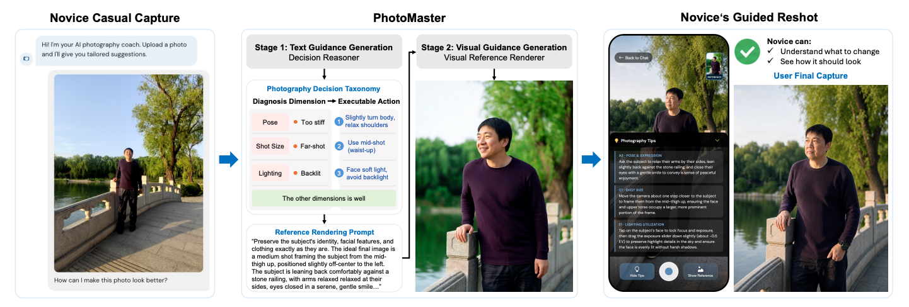
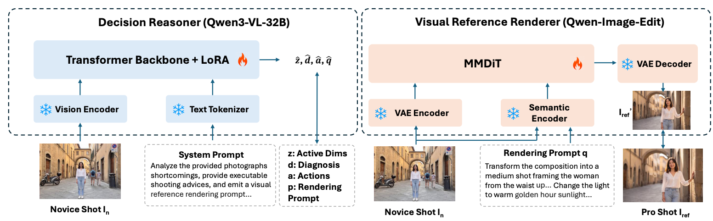

<div align="center">

# PhotoMaster
### Learning Holistic Capture-Time Decisions for Guided Photography Reshooting

**Understand what to change. See how it should look. Capture a better photo.**

Zian Qian · Cheuk Him Chau · Siyue Xie · Chufeng Xiao · Qifeng Chen · Rui Liu · Chenyang Lei

HKUST · Huawei Research

[Paper](https://doi.org/10.1145/3842543) · [Dataset](https://huggingface.co/datasets/qwmqza/PhotoMaster) · [Model weights](https://huggingface.co/WilsonCahu/PhotoMaster) · [Quick start](docs/quickstart.md) · [Release status](docs/release-status.md)

</div>



*Paper Figure 1: an initial photo, PhotoMaster guidance, and the novice's actual guided reshoot. The generated reference and the final camera capture are distinct outputs.*

PhotoMaster helps photographers decide **what to do before taking the next shot**. Given one image, it diagnoses photographic issues, gives practical reshooting actions, and renders a visual target. Its Photography Decision Taxonomy (PDT) covers 12 dimensions across subject, viewpoint, framing and optics, time, light and color, and scene geometry.

## What is included

- **Decision Reasoner:** Qwen3-VL-32B with PhotoMaster fine-tuning, producing PDT diagnoses, actionable advice, and a reference-rendering prompt.
- **Visual Reference Renderer:** Qwen-Image-Edit-2511 with a PhotoMaster fine-tuned transformer checkpoint.
- **Inference code and five example inputs**, plus VLM and DiT training code and experiment configurations.
- **PhotoMaster-Data:** 236,904 triplets reported in the paper, constructed with Forward Decision Transfer and Decision Inversion. See the [data guide](docs/data.md) for the distinction between paper statistics and the downloadable release.

> **Release status:** the hosted checkpoint mapping is documented, and one-image and five-image pipelines completed on a single H20. The included five-image set is an inference demo, not the full 377-case PhotoMaster-Bench. Raw evidence verification, visual review, an environment lock, project licensing and full benchmark reproduction remain release tasks; see the [GPU execution report](docs/gpu-validation.md) and [release status](docs/release-status.md).

## Try PhotoMaster

The current model workers target Linux with NVIDIA CUDA. The recorded one-image and five-image runs used an H20 with 97,871 MiB total memory and reached a highest sampled whole-card usage of 67,781 MiB. See the [GPU execution report](docs/gpu-validation.md) for settings and measurement limits; other GPU memory capacities have not been verified. The paper reports inference on an 80 GB GPU, which is a paper-reported setup rather than a measured minimum requirement.

```bash
git clone https://github.com/zqianaa/PhotoMaster.git
cd PhotoMaster
python -m venv .venv
source .venv/bin/activate
# Install the PyTorch build appropriate for your CUDA setup first.
python -m pip install -r requirements-inference.txt

# Check the included example inputs without downloading any weights.
python scripts/check_setup.py --data-only
```

Follow the [quick start](docs/quickstart.md) to place the base models and PhotoMaster checkpoints. With those files in place:

```bash
# Use the complete published PhotoMaster transformer checkpoint.
export FT_CKPT_PATH="$PWD/models/ft_ckpts/i2i/photomaster_i2i.safetensors"
export FT_CKPT_IS_FULL=1
python scripts/check_setup.py --ft-ckpt "$FT_CKPT_PATH"
GPU_MODE=single RUN_NAME=photomaster_demo \
  bash scripts/inference/run_pipeline.sh vlm photomaster_bench
```

Results appear in `bench/photomaster_bench/results/photomaster_demo/`:

```text
vlm_output.json       # diagnoses, reshooting actions and rendering prompts
dit_input.jsonl      # prompt/image inputs for the renderer
qwen_edit_images/    # generated visual references
```

To use your own photo:

```bash
python scripts/inference/prepare_input.py /path/to/photo.jpg --name demo_my_photo
FT_CKPT_IS_FULL=1 GPU_MODE=single RUN_NAME=photomaster_demo \
  bash scripts/inference/run_pipeline.sh vlm demo_my_photo
```

Keep `FT_CKPT_PATH` exported and `FT_CKPT_IS_FULL=1` for the published complete checkpoint. This mode also supports omitting the base transformer weight files as described in the [quick start](docs/quickstart.md); partial checkpoints use the default loading mode with all base weights. Personal `demo_*` inputs and generated results are gitignored.

## How it works



1. **Diagnose and plan.** The VLM observes the input and produces dimension-wise diagnoses and executable actions.
2. **Render a reference.** The original image and the VLM's rendering prompt condition the DiT.
3. **Reshoot.** The photographer uses the advice and visual target to take another photo.

The code exposes `Issues_Analysis`, `Professional_Suggestions`, and `Image_Editing_Prompt`. Background and Compositional Structure are diagnosis-only dimensions; their remedies are expressed through controllable dimensions such as camera position or shot size. See [PDT and output format](docs/pdt.md).

## Results reported in the paper

| Evaluation | PhotoMaster | What is measured |
|---|---:|---|
| PDT diagnosis | **0.787** macro F1 | Decision-level diagnosis on the 377-case benchmark |
| Reference instruction following | **2.71 / 3** | VLM judge score, paper Table 5 |
| Generated-reference preference | **65.23%** | Human preference over the original input, paper Table 4 |
| Real guided-reshoot preference | **86.67%** | Blind comparisons over 60 sessions: 12 participants × 5 scenes |

These are paper-reported results, not measurements from the five bundled examples. The two preference rates evaluate different image sets and protocols.

## Training and reproduction

| Task | Guide |
|---|---|
| Inference, checkpoint placement and troubleshooting | [Quick start](docs/quickstart.md) |
| Single-GPU execution, recorded environment and measurement limits | [GPU execution report](docs/gpu-validation.md) |
| Batch inference, distributed execution and parameters | [Inference reference](scripts/inference/README.md) |
| VLM LoRA fine-tuning | [VLM training](scripts/vlm_train/README.md) |
| DiT fine-tuning | [DiT training](scripts/dit_train/README.md) |
| Data composition and benchmark status | [Data guide](docs/data.md) |
| Remaining work before a public release | [Release status](docs/release-status.md) |

Training launchers preserve the research setup and need environment-specific configuration. In particular, the dataset registry is not bundled, and the data YAMLs contain original cluster paths. They are not yet a portable end-to-end reproduction recipe.

## Limitations

PhotoMaster reasons from a single image and cannot observe off-frame obstacles or determine whether every movement is feasible. Generated references can contain artifacts or identity changes. The paper reports approximately 7.4 seconds for VLM guidance and 36.8 seconds for rendering on a single 80 GB GPU; the current system is not real-time. PDT is an operational taxonomy informed by a limited expert pool and does not represent every photographic style.

## Citation

Bibliographic details below follow the supplied camera-ready paper.

```bibtex
@article{qian2026photomaster,
  title = {PhotoMaster: Learning Holistic Capture-Time Decisions for Guided Photography Reshooting},
  author = {Qian, Zian and Chau, Cheuk Him and Xie, Siyue and Xiao, Chufeng and Chen, Qifeng and Liu, Rui and Lei, Chenyang},
  journal = {ACM Transactions on Graphics},
  volume = {45},
  number = {6},
  articleno = {220},
  numpages = {14},
  year = {2026},
  doi = {10.1145/3842543}
}
```

## Licensing and acknowledgments

A project-level code license has not yet been selected in this repository. Do not infer code, checkpoint, or dataset permissions from the paper's license. Existing third-party notices remain in place; see [third-party components](docs/third-party.md). We thank the Qwen, Hugging Face, LLaMA-Factory, and DiffSynth contributors.
