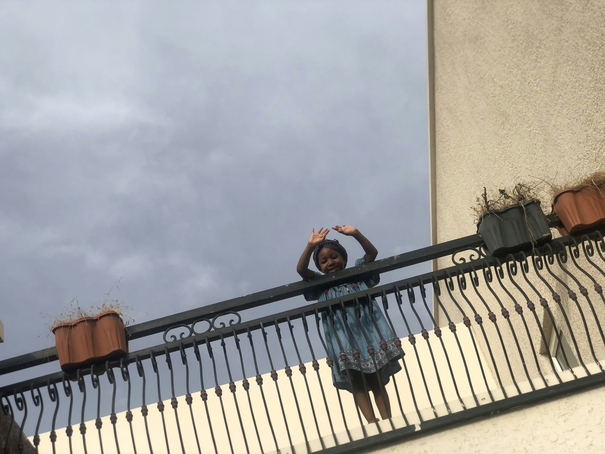
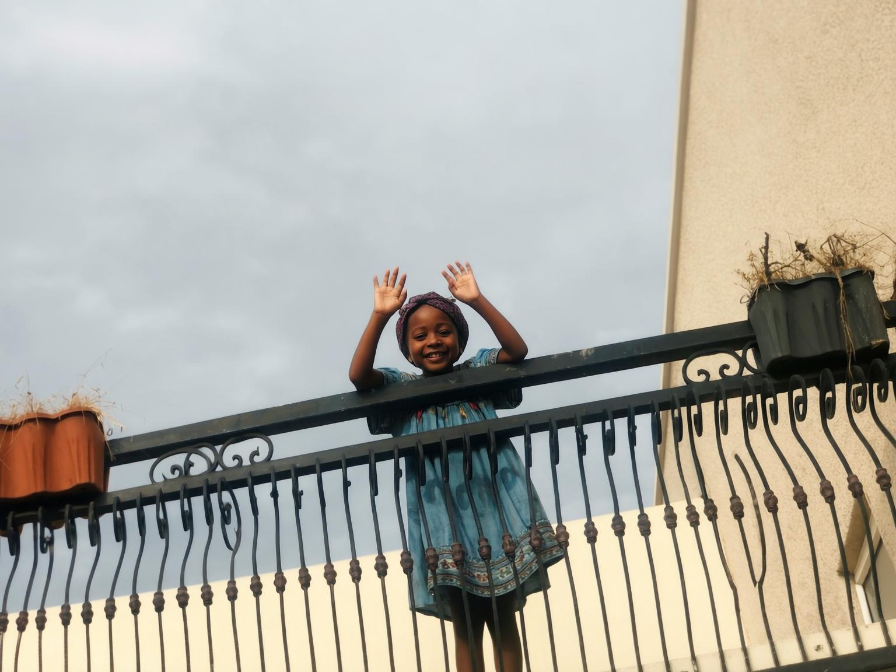
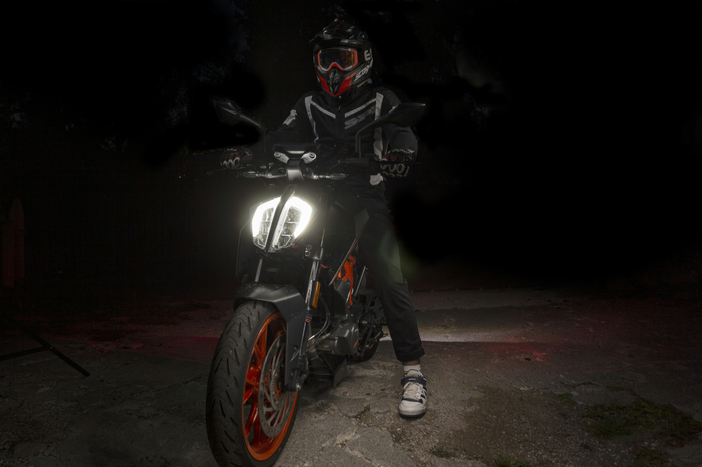
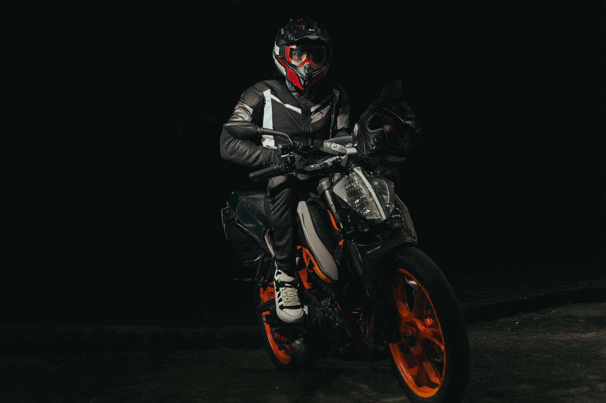
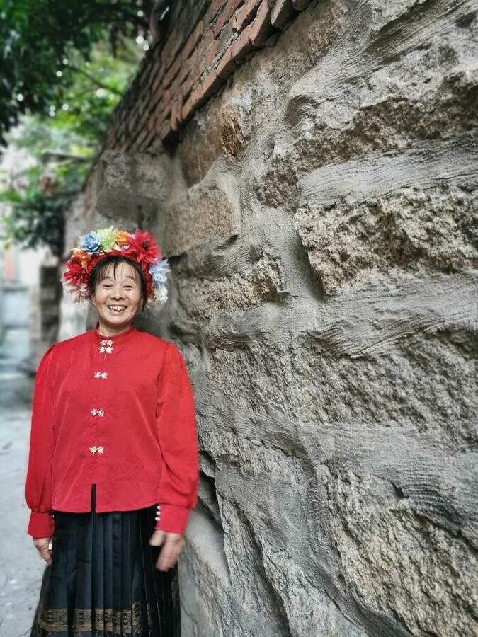
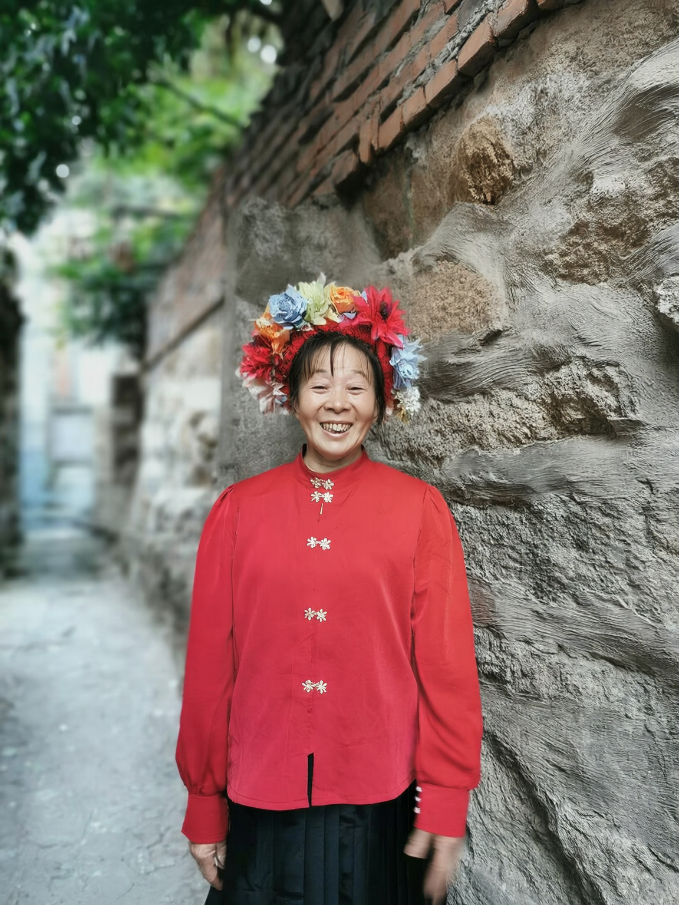
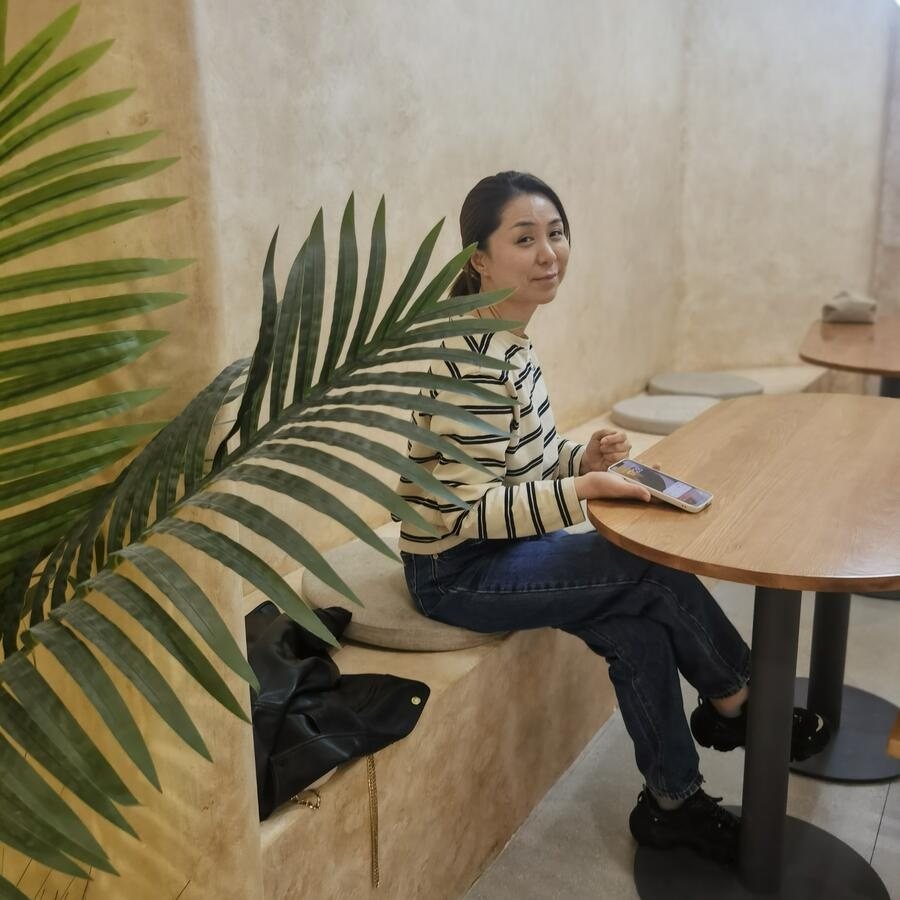
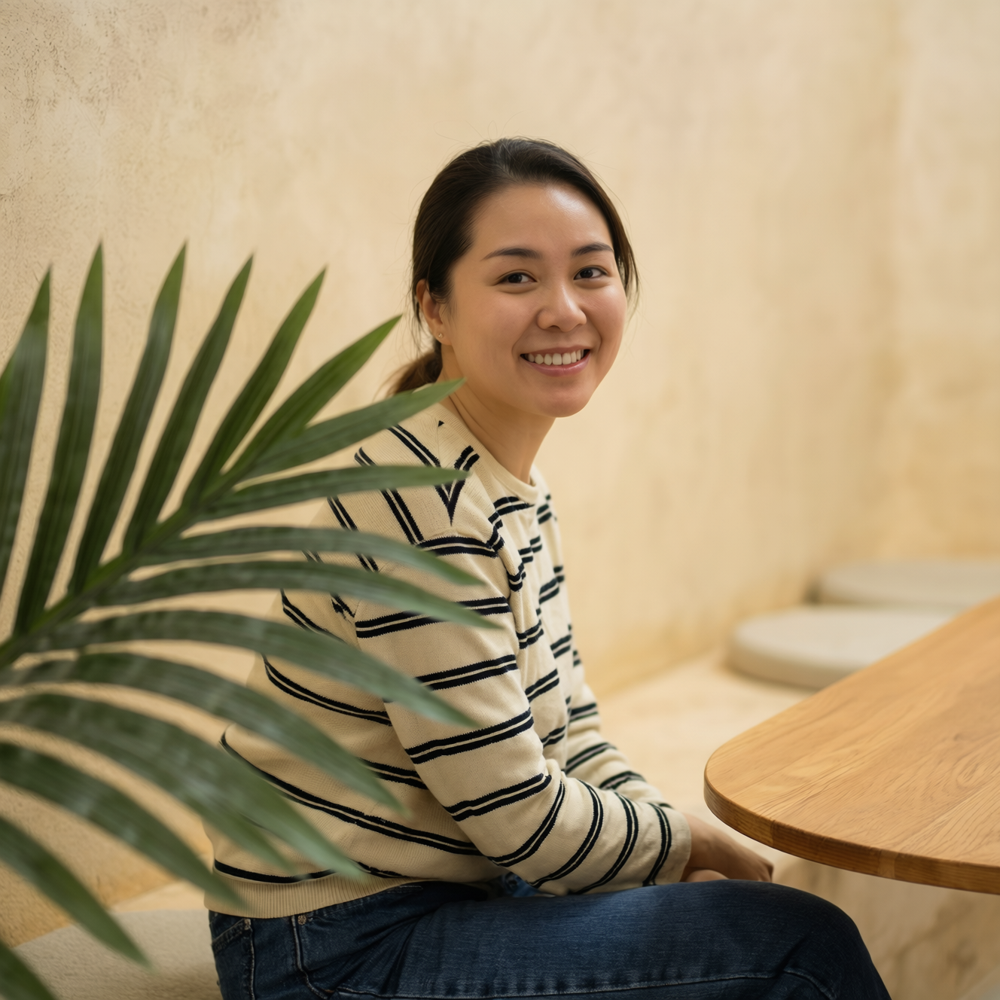
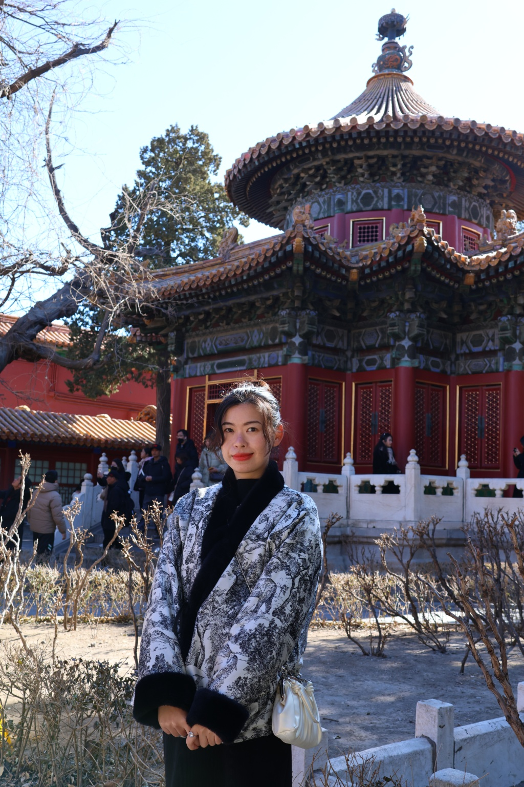
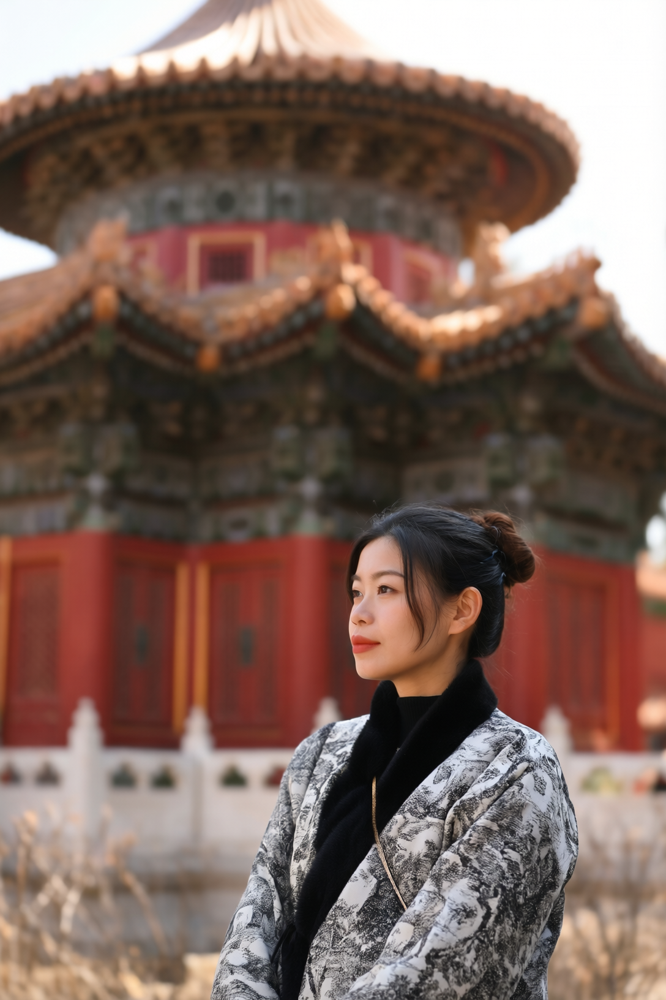

# Recorded example outputs

All five outputs below come from `autodl_h20_demo_05` on October 13, 2026, using one H20 and the settings in the [execution report](gpu-validation.md). The output files are copied byte-for-byte from the verified archive; no retouching or regeneration was applied. All five are shown, including visible failures.

These are **generated visual references**, not photographs captured after following the advice. The notes are a qualitative inspection by the release assistant, not a blinded human evaluation, an identity-preservation test, or a reproduction of paper metrics. Model advice may request movements or lighting changes that cannot be established as feasible from one image.

[Raw model outputs and run evidence](validation/h20-20261013/README.md) · [Reproduce this run](quickstart.md)

## Balcony

Example ID: `1` · `-3hNHA9I5qo.jpg`

<table><tr><th>Input photo</th><th>Generated reference</th></tr><tr>

<td width="50%"></td>

<td width="50%"></td>

</tr></table>

**Observed result:** The face is brighter, the subject is more central and the smile/gaze are clearer. The output still shows a broad low-angle view rather than a tight medium shot; the railing and face details are regenerated.

Model-generated reshooting advice and rendering prompt

**Reshooting advice (verbatim)**

> 【A2 Pose & Expression】Ask the subject to lift her head, look directly into the lens, and smile broadly to create a strong, engaging connection with the viewer.
> 【E1 Lighting Utilization】Wait for or position the subject so that soft, directional sunlight illuminates her face from the front or side, and tap on her face to meter, dragging the exposure slider up by +0.5 EV to brighten her features.

**Rendering prompt (verbatim)**

> Preserve the subject's identity, clothing, and the architectural elements of the balcony. The ideal final image features the young girl standing on the balcony, framed in a medium shot from a slightly low angle. She is positioned centrally, leaning slightly over the black wrought-iron railing. Her pose is dynamic, with her hands raised near her head, and her expression is joyful, looking directly into the camera with a bright smile. The lighting is soft and directional, illuminating her face clearly and adding depth to her features, contrasting nicely with the slightly overcast sky in the background. The depth of field is moderate, keeping both the girl and the immediate balcony railing in sharp focus while the background sky remains softly textured. The overall color palette is natural and balanced, emphasizing the warm tones of her skin and the blue of her dress against the neutral background.

## Motorcycle — visible failure case

Example ID: `3` · `-XIExTKngYE.jpg`

<table><tr><th>Input photo</th><th>Generated reference</th></tr><tr>

<td width="50%"></td>

<td width="50%"></td>

</tr></table>

**Observed result:** The tripod is removed and the rider is brighter, but an extra helmet-like object appears near the right handlebar. Motorcycle, footwear and gear details change, the headlamp looks unlit, and large dark empty regions remain. This does not satisfy the prompt’s exact-preservation request.

Model-generated reshooting advice and rendering prompt

**Reshooting advice (verbatim)**

> 【B1 Camera Position】Take approximately two steps to the right and half a step forward to center the motorcycle within the frame, completely excluding the tripod leg visible on the far left edge.
> 【C1 Shot Size】Zoom in slightly or physically move closer until the motorcycle and rider occupy about 80% of the frame's height, reducing the empty black space on the right side.
> 【E1 Lighting Utilization】Tap on the motorcycle's headlight on your screen to lock focus and exposure, then drag the exposure slider down by about -1.0 to -1.5 EV to retain the intricate details of the headlamp. If using a flash, diffuse it with a softbox or bounce it off a nearby surface to create softer, more even illumination on the rider and bike.

**Rendering prompt (verbatim)**

> Preserve the identity of the rider, the specific motorcycle model, and the rider's gear exactly as they are. The ideal final image is a striking night portrait of a motorcyclist. The subject is perfectly centered in the frame (Subject Placement), sitting confidently on the bike with a poised posture (Pose & Expression). The camera is positioned at a low, eye-level angle relative to the rider's chest, creating an imposing and heroic perspective (Camera Position & Angle). The framing is a tight medium shot, with the motorcycle and rider occupying the majority of the frame, eliminating unnecessary empty space and peripheral distractions (Shot Size). The depth of field is moderate, keeping both the rider and the motorcycle in sharp focus while the background gently falls off into darkness (Depth of Field). The lighting is dramatic but controlled; the headlight is properly exposed, revealing the intricate mechanical details of the lamp without blowing out, while the rider is illuminated by soft, diffused light that highlights the textures of the leather and gear (Lighting Utilization). The overall color palette features a moody, high-contrast aesthetic with deep blacks, accented by the vibrant orange of the bike's wheels and the cool, cinematic tones of the rider's gear (Color & Tonal Key). The background is a clean, deep black void, ensuring the viewer's attention remains entirely on the illuminated subject (Background).

## Stone-wall portrait

Example ID: `6` · `00000111_5270.png`

<table><tr><th>Input photo</th><th>Generated reference</th></tr><tr>

<td width="50%"></td>

<td width="50%"></td>

</tr></table>

**Observed result:** The subject becomes more central and the alley is softer. However, the crop is tighter rather than the requested wider mid-thigh view, and hand edges are visibly blurred. Facial, clothing and wall details are regenerated.

Model-generated reshooting advice and rendering prompt

**Reshooting advice (verbatim)**

> 【B1 Camera Position】Take approximately two steps to the right and pivot the camera slightly to the left. This will shift the subject toward the center of the frame and reduce the overwhelming presence of the stone wall.
> 【C1 Shot Size】Zoom out slightly or step back until the subject is framed from the mid-thigh up, ensuring the subject occupies about 50% of the frame height and leaving visible negative space above the floral headpiece.

**Rendering prompt (verbatim)**

> Preserve the subject's identity, facial features, red traditional clothing, and floral headpiece exactly as they are. The ideal final image is a beautifully balanced portrait where the subject is positioned centrally in the frame, framed in a medium shot from the mid-thigh up. The camera is positioned at eye level, capturing the subject's warm, genuine smile. The depth of field is moderate, keeping the subject in sharp focus while the background alleyway gently falls out of focus. Soft, natural daylight illuminates the subject evenly, highlighting the vibrant red of her dress against the muted, earthy tones of the rustic stone wall behind her. The composition balances the subject with the textured wall, ensuring the wall does not overpower the frame, while the background alleyway provides a subtle, atmospheric depth to the overall scene.

## Cafe portrait

Example ID: `10` · `00000143_8300.png`

<table><tr><th>Input photo</th><th>Generated reference</th></tr><tr>

<td width="50%"></td>

<td width="50%"></td>

</tr></table>

**Observed result:** Closer framing, a broader smile and a softer background follow parts of the advice. The arms remain in the lap instead of resting on the table, and the palm still overlaps the torso. Facial and sweater details change.

Model-generated reshooting advice and rendering prompt

**Reshooting advice (verbatim)**

> 【A1 Subject Placement】Position the subject so her face is near the upper right intersection of the rule of thirds grid, allowing the plant to serve as a framing element on the left rather than an obstruction.
> 【A2 Pose & Expression】Ask the subject to sit up straight, uncross her legs, and rest her arms naturally on the table. Direct her to look directly into the camera lens with a relaxed, engaging smile.
> 【B1 Camera Position】Take one step to the right and move closer to the subject to change the perspective, ensuring the palm frond frames the left side of the image rather than cutting across the subject's face.
> 【C1 Shot Size】Frame the shot as a medium close-up, cropping just below the subject's waist, to emphasize her facial expression and upper body while reducing the prominence of the lower seating area.

**Rendering prompt (verbatim)**

> Preserve the subject's identity, facial features, and the striped sweater and jeans she is wearing. The final image should be a medium close-up portrait of the woman sitting at a wooden cafe table. The camera is positioned at eye level, slightly to the right, framing her face near the upper right rule of thirds intersection. She is sitting upright with her arms resting naturally on the table, looking directly into the lens with a warm, engaging smile. The large green palm frond is positioned on the left side of the frame, serving as a vibrant foreground element that frames her rather than obscuring her face. The background consists of a softly textured, warm-toned wall. The depth of field is shallow, keeping the subject and the immediate table surface in sharp focus while gently blurring the background wall and the plant. The lighting is soft and even, highlighting her facial features without harsh shadows, creating a warm, inviting, and harmonious color palette.

## Pavilion portrait

Example ID: `12` · `00000197_4980.png`

<table><tr><th>Input photo</th><th>Generated reference</th></tr><tr>

<td width="50%"></td>

<td width="50%"></td>

</tr></table>

**Observed result:** The closer side-facing portrait and blurred pavilion broadly follow the rendering prompt. People and much of the foreground disappear rather than merely blur; architecture, face and garment details are reconstructed. The subject does not align precisely to the requested right-third placement.

Model-generated reshooting advice and rendering prompt

**Reshooting advice (verbatim)**

> 【A1 Subject Placement】Position the subject in the lower right quadrant of the frame, ensuring her face is aligned with the right vertical third line, allowing the pavilion to occupy the upper left.
> 【B1 Camera Position】Move laterally to the right and slightly forward to align the subject directly in front of the pavilion's central entrance, using the architectural lines to frame her.
> 【C2 Depth of Field】Switch to Portrait Mode or use a wider aperture (equivalent to f/2.8) and tap on the subject's face to focus, blurring the background pedestrians and architecture to isolate the subject.

**Rendering prompt (verbatim)**

> Preserve the subject's identity, facial features, and clothing exactly as they are. The ideal final image is a portrait set against a traditional Chinese pavilion. The subject is positioned in the lower right quadrant, facing slightly towards the left, with her face aligned along the right vertical third line. The camera angle is at eye-level, capturing a medium shot that includes her upper body and face. The background features a red and gold traditional pavilion, but it is rendered with a shallow depth of field, softly blurring the architectural details and any background pedestrians to ensure the subject stands out sharply. The lighting is soft and natural, highlighting the subject's face evenly without harsh shadows. The overall color palette is warm and harmonious, emphasizing the rich reds of the pavilion and the natural tones of the subject's skin and hair, creating a serene and timeless atmosphere.

